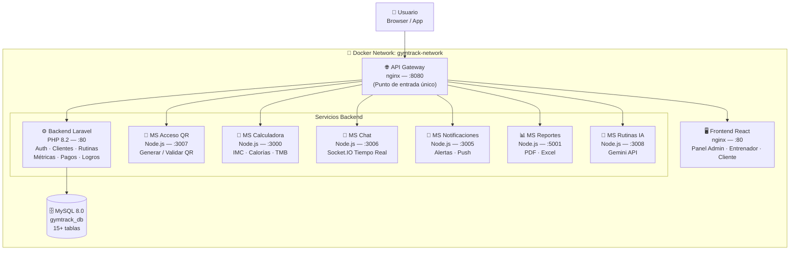
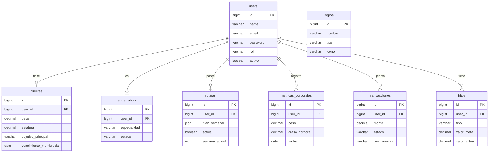

# Proyecto Final — GymTrack
## Sistema de Gestión de Gimnasio con Arquitectura de Microservicios

| Campo | Detalle |
|---|---|
| **Programa** | Tecnología en Sistemas |
| **Materia** | Desarrollo de Software III |
| **Docente** | Mg(c). Juan Pablo Pinillos Reina |
| **Proyecto** | GymTrack — Plataforma Integral de Gestión de Gimnasio |

---

## 1. Descripción del Problema

El sector fitness ha experimentado un crecimiento significativo en los últimos años, con una demanda creciente de servicios personalizados que combinen tecnología y bienestar físico. Sin embargo, la mayoría de los gimnasios de tamaño mediano en Colombia enfrentan un problema común: dependen de sistemas fragmentados y procesos manuales para gestionar sus operaciones, lo que genera ineficiencias, pérdidas de información y una experiencia deficiente tanto para clientes como para entrenadores y administradores.

Específicamente, los problemas más frecuentes son:
- **Gestión manual de membresías**: el control de pagos, vencimientos y renovaciones se lleva en planillas o sistemas desconectados.
- **Ausencia de planes de entrenamiento personalizados**: los entrenadores diseñan rutinas en papel sin seguimiento digital del progreso del cliente.
- **Falta de comunicación en tiempo real**: no hay canales directos entre entrenadores y clientes para resolver dudas o hacer seguimiento.
- **Reportes inexistentes**: los administradores no tienen datos consolidados para tomar decisiones sobre asistencia, ingresos o rendimiento.
- **Control de acceso obsoleto**: el ingreso físico al gimnasio se gestiona de forma manual, sin validación digital de membresías activas.

GymTrack nace como solución integral a estos problemas, centralizando en una única plataforma todas las operaciones del gimnasio, con un diseño moderno basado en microservicios que garantiza escalabilidad, disponibilidad y mantenibilidad.

El sistema tiene tres tipos de usuarios finales:
- **Administradores**: gestionan clientes, entrenadores, membresías, ingresos y tienen acceso a reportes y analíticas.
- **Entrenadores**: visualizan y gestionan sus clientes asignados, diseñan planes de entrenamiento y se comunican con sus clientes.
- **Clientes**: acceden a su rutina personalizada generada por IA, registran métricas corporales, reciben notificaciones y pueden comunicarse con su entrenador.

---

## 2. Objetivo General de la Aplicación

Desarrollar una aplicación web basada en arquitectura de microservicios que permita gestionar de manera integral las operaciones de un gimnasio (autenticación de usuarios, control de membresías, generación de rutinas personalizadas con Inteligencia Artificial, control de acceso mediante códigos QR, comunicación en tiempo real, reportes descargables y cálculos de salud), con persistencia de datos en MySQL, despliegue completo mediante Docker y orquestación a través de un API Gateway.

---

## 3. Objetivos Específicos

1. **Diseñar la estructura de base de datos relacional** con un mínimo de 10 entidades relacionadas mediante llaves foráneas, que represente correctamente los dominios del negocio: usuarios, clientes, entrenadores, rutinas, membresías, métricas, transacciones y logros.

2. **Implementar un API REST 100% funcional** con el backend Laravel (PHP 8.2), incluyendo CRUD completo para las entidades de Clientes, Rutinas y Métricas Corporales, con autenticación mediante tokens JWT (Laravel Sanctum).

3. **Desarrollar al menos 3 microservicios independientes** con responsabilidades claramente delimitadas: Acceso QR (validación de membresías), Chat en Tiempo Real (Socket.IO), Generación de Reportes (PDF/Excel) y Cálculos de Salud (IMC/calorías).

4. **Integrar el patrón API Gateway** mediante nginx como punto de entrada único al sistema, enrutando las peticiones hacia el microservicio correspondiente según el path de la URL, ocultando la topología interna de la red.

5. **Contenerizar cada servicio con Docker** (Dockerfile individual) y orquestar el sistema completo con `docker-compose`, permitiendo levantar toda la plataforma con un solo comando: `docker-compose up --build`.

6. **Integrar la API de Google Gemini** en el microservicio de rutinas para la generación automática de planes de entrenamiento semanales personalizados, basados en datos físicos y objetivos del cliente.

7. **Implementar el frontend en React** con navegación entre paneles diferenciados por rol (administrador, entrenador, cliente), integración con todos los microservicios y experiencia de usuario moderna con animaciones y diseño responsive.

8. **Gestionar el repositorio en Git/GitHub** con historial de commits organizado, archivo `.gitignore` apropiado y documentación técnica incluida.

---

## 4. Justificación de la Aplicación

### ¿Por qué se eligió esta temática?

El sector fitness en Colombia mueve más de 1,2 billones de pesos anuales según datos de la Cámara de Comercio de Bogotá (2024), con más de 4.000 gimnasios registrados a nivel nacional. La mayoría de estos establecimientos, especialmente los de tamaño mediano, carecen de sistemas integrados y modernos para la gestión de sus operaciones. Esta brecha tecnológica representa una oportunidad real de impacto con el desarrollo de GymTrack.

### ¿Qué problema real resuelve?

GymTrack resuelve el problema de la **fragmentación operativa** en los gimnasios, centralizando en una sola plataforma lo que antes se manejaba con hojas de cálculo, mensajes de WhatsApp, agendas físicas y sistemas desconectados. La plataforma permite:

- Registrar y controlar membresías con vencimiento automático y pasarela de pagos.
- Generar rutinas de entrenamiento personalizadas mediante IA sin necesidad de un entrenador físico presente.
- Validar el acceso físico al gimnasio mediante códigos QR que verifican en tiempo real si la membresía está activa.
- Monitorear el progreso del cliente con métricas corporales y gráficas de evolución.
- Generar reportes PDF/Excel de ingresos, asistencia y clientes para decisiones administrativas.

### ¿Quién lo usaría?

- **Propietarios/administradores de gimnasios** que necesitan control total sobre el negocio.
- **Entrenadores personales** que buscan digitalizar el seguimiento de sus clientes.
- **Clientes del gimnasio** que desean acceso digital a sus rutinas, progreso y planes de alimentación.

### Ventajas de la arquitectura de microservicios

La elección de microservicios no es arbitraria: cada componente del sistema tiene requerimientos de disponibilidad y escalado diferentes. El microservicio de chat necesita mantener conexiones WebSocket persistentes; el de reportes realiza operaciones computacionalmente intensivas; el de acceso QR debe responder en milisegundos. Con una arquitectura monolítica, el fallo de cualquiera de estos módulos podría derribar toda la aplicación. Con microservicios, cada componente falla de forma aislada y puede escalarse independientemente.

---

## 5. Patrón de Microservicio Utilizado

### 5.1 API Gateway Pattern

El patrón principal implementado es el **API Gateway**. Se utilizó **nginx** como API Gateway, el cual actúa como el único punto de entrada al sistema desde el exterior. El cliente (browser) nunca se comunica directamente con los servicios internos; toda petición pasa por el gateway en el puerto `8080`.

**Responsabilidades del Gateway:**
- **Enrutamiento**: dirige cada petición al microservicio correcto según el path de la URL.
- **Abstracción de red**: oculta los puertos y hosts internos de cada servicio.
- **Proxy inverso**: gestiona la comunicación entre frontend y backend sin exponer la topología interna.

**Tabla de enrutamiento del Gateway:**

| Path del Request | Servicio Destino | Puerto Interno |
|---|---|---|
| `/api/auth/*` | Backend Laravel | 80 |
| `/api/clientes/*` | Backend Laravel | 80 |
| `/api/rutinas/*` | Backend Laravel | 80 |
| `/api/metricas/*` | Backend Laravel | 80 |
| `/api/transacciones/*` | Backend Laravel | 80 |
| `/api/reportes/*` | MS Reportes | 5001 |
| `/api/acceso/*` | MS Acceso QR | 3007 |
| `/api/calculadora/*` | MS Calculadora | 3000 |
| `/api/chat/*` | MS Chat | 3006 |
| `/api/notificaciones/*` | MS Notificaciones | 3005 |
| `/api/ms-rutinas/*` | MS Rutinas IA | 3008 |
| `/socket.io/*` | MS Chat (WebSocket) | 3006 |
| `/` | Frontend React | 80 |

### 5.2 Patrón DTO + Services + Repository (Backend Laravel)

El backend Laravel implementa el patrón **Repository + Service Layer** mediante Eloquent ORM:

- **Models (Entidades)**: `User`, `Cliente`, `Entrenador`, `Rutina`, `MetricaCorporal`, `Transaccion`, `Logro`, `Hito`, `PlanAlimentacion`.
- **Controllers (API REST)**: 18 controladores en `/app/Http/Controllers/API/` que gestionan la lógica de cada dominio.
- **Resources (DTOs)**: Eloquent Resources para transformar modelos a JSON estructurado antes de enviar al cliente.
- **Sanctum (Auth)**: Autenticación stateless con tokens Bearer (JWT-compatible).

### 5.3 Comunicación entre Servicios

Los microservicios se comunican de las siguientes formas:

| Tipo | Usado por | Protocolo |
|---|---|---|
| REST HTTP | Todos los microservicios con el gateway | HTTP/1.1 JSON |
| WebSocket (Socket.IO) | MS Chat | WS/WSS |
| Consultas directas a MySQL | Backend Laravel | TCP MySQL Protocol |

No existe comunicación directa entre microservicios (patrón **Shared-Nothing**); cada uno es completamente autónomo y sin dependencias entre ellos.

---

## 6. Arquitectura General

### 6.1 Diagrama de Arquitectura



### 6.2 Descripción Detallada de Microservicios

#### 🔧 Backend Laravel — Servicio Principal
- **Tecnología**: PHP 8.2 + Laravel 12 + Sanctum
- **Puerto interno**: 80
- **Responsabilidad**: Núcleo del negocio. Gestiona autenticación, usuarios, clientes, entrenadores, rutinas, métricas, pagos, logros, hitos y planes de alimentación.
- **Endpoints principales**:
  - `POST /api/auth/login` — Autenticación
  - `POST /api/auth/register` — Registro de nuevo cliente
  - `GET /api/clientes` — Listar clientes (admin)
  - `PUT /api/clientes/{id}` — Actualizar perfil de cliente
  - `POST /api/rutinas/generar` — Generar rutina con IA
  - `GET /api/metricas` — Métricas del cliente autenticado
  - `POST /api/metricas` — Registrar nueva métrica
  - `GET /api/transacciones` — Historial de pagos
  - `POST /api/membresia/renovar` — Renovar membresía

#### 🔐 Microservicio de Acceso QR
- **Tecnología**: Node.js 20 + Express + QRCode
- **Puerto interno**: 3007
- **Responsabilidad**: Genera y valida códigos QR para control de acceso físico al gimnasio, verificando si la membresía del usuario está activa.
- **Endpoints**:
  - `POST /api/acceso/generar-qr` — Genera QR en Base64
  - `POST /api/acceso/validar-qr` — Valida QR y devuelve estado de acceso
  - `GET /health` — Health check

#### 🧮 Microservicio Calculadora
- **Tecnología**: Node.js 20 + Express
- **Puerto interno**: 3000
- **Responsabilidad**: Cálculos de salud: IMC (Índice de Masa Corporal), TMB (Tasa Metabólica Basal) y requerimiento calórico diario.
- **Endpoints**:
  - `POST /api/calculadora/imc` — Calcula IMC y categoría
  - `POST /api/calculadora/calorias` — Calcula TDEE según actividad

#### 💬 Microservicio Chat
- **Tecnología**: Node.js 20 + Express + Socket.IO
- **Puerto interno**: 3006
- **Responsabilidad**: Chat en tiempo real entre clientes, entrenadores y administradores. Maneja salas de conversación (`admin`, `entrenador-{id}`, `general`).
- **Eventos Socket.IO**:
  - `join_room` — Unirse a una sala de chat
  - `send_message` — Enviar mensaje
  - `chat_history` — Recibir historial al conectarse

#### 🔔 Microservicio Notificaciones
- **Tecnología**: Node.js 20 + Express
- **Puerto interno**: 3005
- **Responsabilidad**: Gestión de notificaciones push y alertas del sistema (membresía próxima a vencer, rutina generada, nuevo mensaje de entrenador).
- **Endpoints**:
  - `POST /api/notificaciones/enviar` — Crear notificación
  - `GET /api/notificaciones/{userId}` — Obtener notificaciones del usuario

#### 📊 Microservicio Reportes
- **Tecnología**: Node.js 20 + Express + PDFKit + ExcelJS
- **Puerto interno**: 5001
- **Responsabilidad**: Generación de reportes descargables en formato PDF y Excel para los administradores (ingresos, asistencia, listado de clientes).
- **Endpoints**:
  - `POST /api/reportes/pdf` — Generar reporte PDF
  - `POST /api/reportes/excel` — Generar reporte Excel
  - `GET /health` — Health check

#### 🤖 Microservicio Rutinas IA
- **Tecnología**: Node.js 20 + Express + Google Gemini API
- **Puerto interno**: 3008
- **Responsabilidad**: Generación de planes de entrenamiento semanales personalizados usando la API de Google Gemini, con contexto del usuario (peso, estatura, objetivo, lesiones, frecuencia de entrenamiento).

---

### 6.3 Estructura de Base de Datos

La base de datos `gymtrack_db` contiene 15 tablas relacionadas. Las principales con sus relaciones:

#### Diagrama Entidad-Relación (simplificado)



#### Resumen de tablas con FK

| Tabla | Descripción | FK principal |
|---|---|---|
| `users` | Usuarios del sistema (admin, entrenador, cliente) | — |
| `clientes` | Perfil extendido del cliente con datos físicos | `user_id → users.id` |
| `entrenadors` | Perfil del entrenador con certificaciones | `user_id → users.id` |
| `rutinas` | Plan semanal de entrenamiento (JSON) | `user_id → users.id` |
| `rutina_progresos` | Progreso por ejercicio en cada rutina | `rutina_id → rutinas.id` |
| `metricas_corporales` | Peso, grasa, masa muscular por fecha | `user_id → users.id` |
| `entrenamientos` | Sesiones de entrenamiento completadas | `user_id → users.id` |
| `entrenamiento_ejercicios` | Ejercicios de cada sesión con series/reps | `entrenamiento_id` |
| `transacciones` | Pagos y membresías | `user_id → users.id` |
| `hitos` | Metas personales del cliente | `user_id → users.id` |
| `logros` | Badges/logros del sistema | — |
| `clases` | Clases grupales del gimnasio | — |
| `ia_mensajes` | Historial de mensajes con el chatbot IA | `user_id → users.id` |
| `planes_alimentacion` | Plan nutricional semanal (JSON) | `user_id → users.id` |
| `personal_access_tokens` | Tokens Sanctum de sesión | `tokenable_id → users.id` |

---


## 8. Instrucciones de Despliegue con Docker

### Requisitos previos
- Docker Desktop instalado (versión 24+)
- Docker Compose (incluido en Docker Desktop)
- Git

### Pasos de instalación

```bash
# 1. Clonar el repositorio
git clone https://github.com/[usuario]/gymtrack.git
cd gymtrack

# 2. Levantar todo el sistema
docker-compose up --build

# 3. En otra terminal, correr las migraciones (primera vez)
docker-compose exec backend php artisan migrate --seed

# 4. Cargar datos iniciales (opcional)
docker-compose exec -T mysql mysql -u gymtrack -pgymtrack_pass gymtrack_db < database/data_inicial.sql

# El sistema estará disponible en:
# http://localhost:8080
```

### Servicios levantados por Docker

| Servicio | URL interna | Acceso externo |
|---|---|---|
| API Gateway (nginx) | gateway:80 | http://localhost:8080 |
| Frontend React | frontend:80 | (via gateway) |
| Backend Laravel | backend:80 | (via gateway) |
| MySQL | mysql:3306 | localhost:3306 |
| MS Acceso QR | microservicio-acceso:3007 | (via gateway) |
| MS Calculadora | microservicio-calculadora:3000 | (via gateway) |
| MS Chat | microservicio-chat:3006 | (via gateway) |
| MS Notificaciones | microservicio-notificaciones:3005 | (via gateway) |
| MS Reportes | microservicio-reportes:5001 | (via gateway) |
| MS Rutinas IA | microservicio-rutinas:3008 | (via gateway) |

### Credenciales de prueba

| Rol | Email | Contraseña |
|---|---|---|
| Administrador | admin@gymtrack.com | password123 |
| Entrenador | carlos@gymtrack.com | password123 |
| Cliente | juan@gymtrack.com | password123 |

---

## 9. Conclusiones Finales del Proyecto

### 9.1 Dificultades Encontradas

**Configuración de CORS entre microservicios y el Gateway:**
Una de las dificultades más recurrentes fue la gestión de las cabeceras CORS. Al agregar nginx como API Gateway, todas las peticiones del frontend llegaban con el origen `http://localhost:8080` en lugar del servicio individual, lo que obligó a ajustar la configuración de CORS tanto en Laravel (config/cors.php) como en cada microservicio Node.js de forma independiente.

**Integración de WebSockets (Socket.IO) a través del Gateway:**
El microservicio de chat usa Socket.IO, que requiere upgrades de protocolo HTTP → WebSocket. nginx por defecto no hace este upgrade automáticamente. Fue necesario configurar las directivas `proxy_http_version 1.1`, `proxy_set_header Upgrade $http_upgrade` y `proxy_set_header Connection "upgrade"` en la configuración del gateway para soportar conexiones WebSocket persistentes.

**Generación de Rutinas con IA (Gemini API):**
La respuesta de la API de Gemini varía en estructura. En algunos casos devuelve el JSON envuelto en bloques de código Markdown (` ```json ... ``` `), lo que requirió implementar lógica de limpieza con expresiones regulares antes de hacer el `json_decode()`. Además, se implementó un sistema de reintentos con múltiples modelos de Gemini y un generador de rutinas como fallback cuando la API no está disponible.

**Sincronización de servicios en Docker Compose:**
El backend Laravel necesita que MySQL esté completamente listo antes de iniciar. Se configuró el `healthcheck` de MySQL y la directiva `condition: service_healthy` en el `depends_on` del backend para garantizar el orden correcto de arranque.

**Variables de entorno en contenedores:**
El `APP_KEY` de Laravel debe ser consistente entre entornos. En el `docker-compose.yml` se inyecta directamente el valor de producción como variable de entorno para evitar regenerarlo en cada build, lo que rompería las sesiones activas.

### 9.2 Aprendizajes

**Arquitectura de microservicios en la práctica:**
Más allá de la teoría, implementar microservicios en un proyecto real evidenció sus verdaderas ventajas y costos. La independencia de cada servicio permite actualizarlos sin afectar al resto, pero añade complejidad operacional (más procesos que monitorear, más logs que revisar, más configuraciones que mantener).

**Docker como estándar de despliegue:**
Docker demostró ser la herramienta que verdaderamente elimina el problema de "en mi máquina funciona". Con un solo `docker-compose up --build` cualquier desarrollador puede levantar un entorno idéntico al de producción, con la misma versión de PHP, Node.js y MySQL, sin instalar nada adicional.

**Diseño de APIs REST y contratos entre servicios:**
Al tener múltiples servicios consumiendo el mismo backend, se hizo evidente la importancia de diseñar APIs estables con respuestas JSON consistentes. Un cambio en la estructura del JSON de respuesta puede romper silenciosamente múltiples clientes.

**Integración de Inteligencia Artificial en aplicaciones reales:**
La integración con la API de Gemini enseñó que los LLMs son potentes pero no deterministas. Las respuestas pueden variar en formato y estructura, por lo que siempre se debe implementar validación robusta, manejo de errores y un mecanismo de fallback para cuando la IA no puede responder adecuadamente.

**React y estado global en aplicaciones de múltiples roles:**
El manejo del estado del usuario (rol, token, datos del perfil) a través de múltiples paneles (admin, entrenador, cliente) requirió un diseño cuidadoso del flujo de datos. Se utilizó Context API y `localStorage` para mantener la sesión persistente entre recargas de página.

### 9.3 Recomendaciones

**Implementar Service Registry (Consul o Eureka):**
Actualmente el API Gateway tiene las direcciones de los microservicios configuradas de forma estática en el `nginx.conf`. En un entorno de producción con escalado dinámico, sería recomendable implementar un Service Registry (como Consul o Spring Cloud Eureka) para que los servicios se registren automáticamente y el gateway los descubra sin configuración manual.

**Agregar monitoreo con Prometheus + Grafana:**
Para un sistema en producción, es esencial tener visibilidad sobre el estado y rendimiento de cada microservicio. La combinación Prometheus (recolección de métricas) + Grafana (visualización) permite detectar cuellos de botella, picos de carga y fallos antes de que afecten a los usuarios.

**Implementar Circuit Breaker (Resilience4j o equivalente en Node.js):**
Si el microservicio de Rutinas IA experimenta latencia alta por sobrecarga de la API de Gemini, esta latencia se propaga al cliente. Un Circuit Breaker cortaría el circuito después de N fallos consecutivos y devolvería una respuesta de fallback inmediata, mejorando la resiliencia del sistema.

**Configurar un pipeline CI/CD:**
Automatizar las pruebas y el despliegue con GitHub Actions o GitLab CI permitiría que cada push a la rama principal ejecute automáticamente las pruebas PHPUnit del backend, valide la construcción de las imágenes Docker y despliegue en el servidor de producción, eliminando los pasos manuales propensos a errores humanos.

**Migrar el chat a una solución con persistencia:**
El microservicio de chat actual almacena los mensajes en memoria (variable JavaScript), lo que significa que al reiniciar el contenedor se pierde el historial. Se recomienda integrar Redis con Socket.IO o una base de datos MongoDB para persistir los mensajes del chat.

---

*Documento elaborado como entrega del Proyecto Final — Desarrollo de Software III*
*Fecha: Noviembre 2026*
